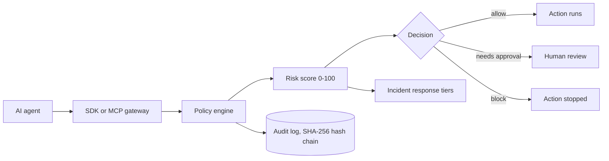

# Aegis: AI Action Control Plane

A policy layer that sits between AI agents and the actions they take. Every action is checked before it runs, given a risk score, and written to a tamper-evident audit log.

**Live demo (demo mode):** https://aegis-demo-r960.onrender.com/app/

## Why I built it

I ran three failure experiments on a live 8-agent system. One unchallenged false data point led to a $100M decision recommendation with no flags, and 8 critical decisions ran with no human oversight. Aegis is my prototype of the controls that were missing. Write-up: https://www.linkedin.com/pulse/i-ran-3-experiments-my-own-ai-system-results-scared-me-murali-revuri

## How it works

## Features

- Persisted policy engine with wildcard matching, plus an "AI Constitution" of non-negotiable overrides
- Deterministic risk score (0-100) per action, with a blast-radius engine
- Three-tier incident response: Active, Restricted, Quarantined
- Audit log in SQLite with a SHA-256 hash chain, so tampering is detectable
- Policy compiler: plain English to structured rules
- Attack surface analyzer and measured decision latency
- Human auth (bcrypt, sessions), agent API keys bound to one agent ID, role-based access control with role-boundary tests
- Python SDK (`@aegis_guard` decorator), TypeScript SDK, LangGraph and CrewAI adapters
- MCP gateway with 14 tools

## Status and limitations

Working prototype (November 2026). The public demo runs in demo mode. Not yet done: containerisation, multi-tenancy, CI, publishing the SDKs to PyPI and npm, and moving the remaining flat-file data into a database. The source code is private; this repository is a project overview.

## Built with

Python, FastAPI, SQLite, MCP, LangGraph, CrewAI

## Author

Murali Revuri | https://linkedin.com/in/murali-revuri | https://github.com/muralirevuri07-boop
